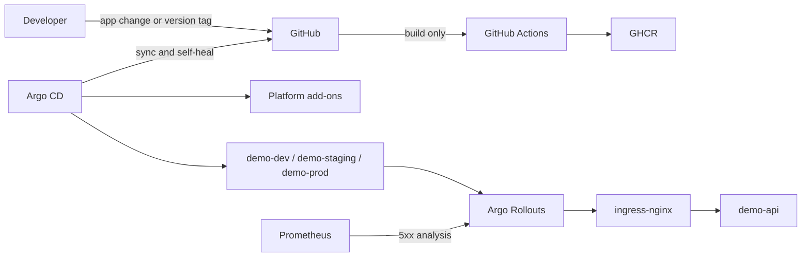

# GitOps Progressive Delivery Platform

This repository demonstrates a local Kubernetes delivery platform for a lightweight `demo-api`
service. kind creates the cluster, Argo CD reconciles platform and application state from Git,
Sealed Secrets encrypts demo credentials, and Argo Rollouts performs canary releases. GitHub
Actions builds images only; changing a Git-managed image tag is what deploys a release.

## Architecture



## Repository layout

```text
bootstrap.sh                     kind cluster and Argo CD bootstrap
kind/                            Default and Calico-enabled kind configurations
app/                             Python demo service and container image
.github/workflows/build.yaml     Build and publish image; no cluster deployment
platform/root-app.yaml           Argo CD app-of-apps entry point
platform/addons/                 Projects, controllers, monitoring, environment ApplicationSet
services/demo-api/base/          Rollout, services, ingress, analysis, network policies
services/demo-api/overlays/       Kustomize settings for dev, staging, and prod
scripts/                         Sealed-secret generation, promotion, traffic, cleanup
```

Environments are directories rather than long-lived Git branches. The ApplicationSet creates
one Argo CD Application for each directory under `services/demo-api/overlays/`.

## Requirements

Docker, kind, kubectl, git, openssl, kubeseal, and Mike Farah `yq` v4. Run shell scripts from WSL
or Git Bash on Windows. The local cluster needs about 4 CPUs, 8 GB RAM, and 20 GB disk.

## Bootstrap

1. Push this repository to the `main` branch on GitHub.
2. In GitHub Actions, confirm the `build-demo-api` workflow succeeds. Publish the
   `ghcr.io/dhinesh181999/demo-api` package as public so the local cluster can pull it.
3. Publish the initial image tag:

   ```bash
   git tag v1.0.0
   git push origin v1.0.0
   ```

4. From the repository root, create the local cluster and bootstrap Argo CD:

   ```bash
   ./bootstrap.sh
   ```

   If NetworkPolicies must be enforced locally, use the Calico cluster configuration:

   ```bash
   NETPOL_CNI=calico ./bootstrap.sh
   ```

5. Once bootstrap has created `.secrets/sealed-secrets.crt`, generate encrypted demo secrets and
   push the resulting ciphertext and Kustomize changes:

   ```bash
   ./scripts/seal.sh
   git add services/demo-api/overlays
   git commit -m "Add encrypted demo secrets"
   git push
   ```

   The app can start before this step because the secret mount is optional. Only encrypted
   `SealedSecret` data is written to Git. Keep `.secrets/` private and backed up; losing the
   private key prevents decryption after a cluster rebuild.

Watch the Argo CD applications:

```bash
kubectl -n argocd get applications -w
```

Visit `http://demo-dev.localtest.me`, `http://demo-staging.localtest.me`, or
`http://demo-prod.localtest.me` after the applications become healthy.

## Release and demonstration

| Demo | Git-driven action | Expected result |
|---|---|---|
| Version update | Push an app change or `v*` tag to build an image, then change `newTag` in the dev overlay | Argo CD syncs and Rollouts deploys the new version |
| Promotion | Run `./scripts/promote.sh dev staging`, review the diff, then commit and push; repeat staging to prod | Environment progression is a Git change |
| Canary traffic | Run `./scripts/traffic.sh prod` while a prod rollout is in progress | Requests exercise the canary and populate ingress metrics |
| Secret rotation | Run `./scripts/seal.sh prod`, then commit and push the encrypted manifest | The response fingerprint changes; the app never returns the secret |
| Drift repair | Run `kubectl scale rollout demo-api -n demo-prod --replicas=7` | Argo CD reports drift and restores the Git-declared replica count of 3 |
| Automated rollback | Keep `./scripts/traffic.sh prod` running, set `ERROR_RATE` to `"1"` in `services/demo-api/overlays/prod/rollout-patch.yaml`, and push | Prometheus analysis fails the canary and Rollouts restores the stable ReplicaSet; revert the Git change afterward |

The drift command is only a demonstration of self-healing. Normal releases and promotions are
made through Git, not manual cluster changes.

## Security and operations

- The demo container runs as a non-root user with a read-only filesystem, dropped capabilities,
  resource requests and limits, and health probes.
- Each environment starts with a deny-all NetworkPolicy; ingress is limited to ingress-nginx
  and egress to cluster DNS. Use Calico locally to enforce these policies.
- Argo CD applications use automated sync, pruning, and self-healing. Image build automation
  does not deploy to Kubernetes.
- Controller and Helm chart versions are pinned in `platform/addons/`. Review upstream releases
  before changing pins.
- This is a local assignment/demo topology. For production, use a managed Kubernetes platform,
  hardened identity/access controls, external secret-key backup, and reviewed ingress/controller
  versions.
