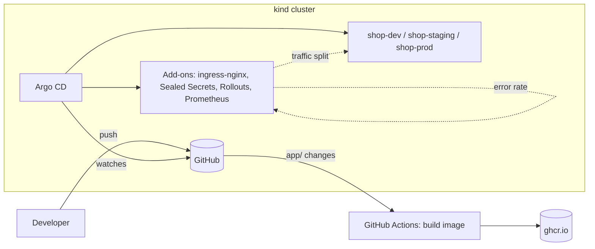

# Shop Delivery Platform

GitOps delivery setup for a small sample service ("storefront") on a local Kubernetes cluster.
Argo CD keeps the cluster in sync with this repo, Argo Rollouts does canary releases, secrets are
stored encrypted with Sealed Secrets, and Prometheus metrics can stop a bad release automatically.

## How it works



1. CI only builds and pushes an image. It never deploys.
2. A release is a commit that changes `newTag` in `services/storefront/overlays/<env>/kustomization.yaml`.
3. Argo CD applies it. Argo Rollouts moves traffic to the new version in steps (10, 30, 60, 100 percent in prod).
4. While that happens, Prometheus checks the canary's 5xx rate. If it is too high, the rollout aborts
   and traffic goes back to the stable version. You then revert the commit so Git matches the cluster.

## Repository layout

```
bootstrap.sh                    cluster + Argo CD + root app (only manual step)
kind/                           cluster configs (default, and one with Calico for network policies)
app/                            Python sample service and Dockerfile
.github/workflows/build.yaml    image build and push
platform/root-app.yaml          entry point Argo CD starts from
platform/addons/                projects, cluster add-ons (Helm, pinned), per-environment ApplicationSet
services/storefront/base/       rollout, services, ingress, analysis template, network policies
services/storefront/overlays/   dev, staging, prod (replicas, canary steps, image tag, host, sealed secret)
scripts/                        helper scripts
```

Environments are folders, not branches. Adding `overlays/qa/` creates a `shop-qa` namespace automatically.

## Requirements

Docker, kind, kubectl, git, openssl, kubeseal, yq. Optional: argocd CLI, kubectl-argo-rollouts.
About 4 CPUs, 8 GB RAM and 20 GB disk. A public GitHub repo.

## Setup

This checkout is configured for https://github.com/Dhinesh181999/gitops.git.
Connect it as `origin` if needed, then commit and push the files to the `main` branch.

```bash
git tag v1.0.0 && git push origin v1.0.0                # CI builds the image; make the package public
                                                        # (or: ./scripts/local-image.sh v1.0.0 <github-user>)

./bootstrap.sh                                          # NETPOL_CNI=calico ./bootstrap.sh if policies aren't enforced
./scripts/seal.sh                                       # encrypt secrets for all environments
git add -A && git commit -m "add sealed secrets" && git push
```

Then open http://shop-prod.localtest.me (`localtest.me` resolves to 127.0.0.1).

## Demo steps

| What | How | Result |
|---|---|---|
| Traffic | `./scripts/traffic.sh prod` | steady requests for the metrics |
| New version | change `newTag` to `v2.0.0` in the prod overlay and push | `kubectl argo rollouts get rollout storefront -n shop-prod -w` |
| Secret rotation | `PAYMENT_API_KEY_PROD=newvalue ./scripts/seal.sh prod`, push | `secret_fingerprint` in the response changes, no restart |
| Drift | `kubectl scale rollout storefront -n shop-prod --replicas=7` | Argo CD marks OutOfSync, then restores 3 |
| Auto rollback | set `ERROR_RATE` to `"1"` in `prod/rollout-patch.yaml`, push | analysis fails, rollout aborts, then `git revert` |
| Promotion | `./scripts/promote.sh dev staging` | tag change shows up as a Git diff |

## Notes

- Only encrypted `SealedSecret` files are in Git. The key pair is created by `bootstrap.sh` in `.secrets/`
  (git-ignored) and reused if the cluster is rebuilt. Secrets are scoped to one namespace, so each overlay has its own.
- The secret is mounted as a folder and read on each request, so rotating it needs no pod restart.
- Argo CD runs with `selfHeal` and `prune`. Service selectors are ignored in diffs because Argo Rollouts adds a hash label to them.
- Pods have requests and limits, run as non-root with a read-only filesystem, and each namespace starts with a deny-all network policy.
- Pinned versions: Argo CD v2.13.3, ingress-nginx 4.11.3, sealed-secrets 2.16.2, argo-rollouts 2.38.0,
  kube-prometheus-stack 66.2.1. Check for newer ones with `helm search repo <chart> --versions`.
  ingress-nginx is retired upstream but still works here.

## Troubleshooting

- `ImagePullBackOff`: the image package is private or the tag doesn't exist.
- Analysis never fails: no traffic is reaching the canary, run `traffic.sh`.
- Apps fail on first sync: CRDs are still installing, the retry settings clear this in a few minutes.
- Secrets won't decrypt after a rebuild: keep the `.secrets/` folder, or run `seal.sh` again.
